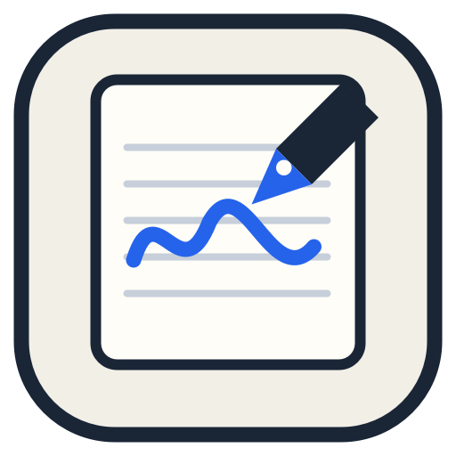

<div align="center">
  

# OpenHand

**Ваш текст. Ваш почерк. На экране и на бумаге.**

Редактор рукописных документов, студия шрифтов и управление перьевым плоттером.

[Открыть в браузере](https://renothingg.github.io/OpenHand/) · [Релизы](https://github.com/ReNothingg/OpenHand/releases) · [Видеообзор](https://www.youtube.com/watch?v=TxZVIGn5Rf8)

macOS · Windows · Web

</div>

---

## От текста к рукописной странице

Напишите текст в Markdown или LaTeX, выберите почерк и настройте лист.
OpenHand разложит материал по страницам и покажет результат до печати.
Готовый документ можно сохранить в PDF, экспортировать в G-code или написать
на бумаге совместимым плоттером.

Редактор, встроенные шрифты и расчёт траекторий работают локально.

## Возможности

| | |
| --- | --- |
| **Документы** | Markdown, LaTeX, формулы, списки и таблицы; импорт XLSX, CSV и TSV |
| **Страницы** | A4, A5, Letter и тетрадный разворот; поля, интервалы и ручная раскладка |
| **Почерк** | Локальные шрифты, авторские профили, варианты букв и соединения |
| **Свой шрифт** | Рисование пером или мышью, импорт фотографии и бланка, формат `.gfont` |
| **Графика** | SVG, DXF, векторизация изображений и мастерская траекторий |
| **Плоттер** | GRBL, Marlin и EBB; USB / Bluetooth Serial и TCP в настольных приложениях; виртуальный плоттер для проверки без станка |
| **Экспорт** | Печать, PDF, G-code, собственные шрифты и настройки |

## Быстрый старт

1. Введите текст во вкладке **«Документ»**.
2. Выберите шрифт, размер листа и поля.
3. Откройте **«Почерк»**, чтобы настроить характер письма.
4. Проверьте страницы и сохраните PDF либо подготовьте запись на плоттере.

Для печати подходит экранный шрифт. Для движения пера нужен однолинейный
**GFont**: встроенный или ваш собственный.

В Markdown можно вставлять формулы в форматах `\( … \)` и `\[ … \]`,
а также `$ … $` и `$$ … $$`. Дроби, степени, корни с индексом и рамки ответов
сохраняют математическую запись в предпросмотре и траектории плоттера.

## Повторяющиеся буквы с разным характером

Включите **«Настоящий почерк»** и настройте **«Автоварианты формы букв»**.
Для GFont меняются очертания петель, дуг и хвостов, а не только размер или толщина
линии. Если в шрифте записано несколько начертаний, OpenHand выбирает их с учётом
положения в слове и добавляет плавные изменения геометрии.

Автоварианты строятся из исходного начертания и сохраняют его узнаваемость.
Новые штрихи не дорисовываются. Оригинальный файл шрифта остаётся прежним.
Один алгоритм используется в документе и предпросмотре студии шрифтов;
в студии значение **0%** показывает записанные формы без автоматического изменения.

Результат воспроизводим: одинаковые текст, настройки и зерно случайности дают
одинаковую траекторию. При обновлении предпросмотра буквы не меняются сами собой.

## Живые строки

Станок выдаёт себя ровностью: все строки начинаются с одной точки, лежат
строго по линейке, слова сидят на одной высоте. Настройка **«Живые строки»**
(раздел «Слова и строки», по умолчанию 55%) убирает эту ровность. Каждая
строка начинается чуть дальше или ближе к полю (до 1,4 мм), слегка уходит
вверх или вниз (до 0,4°), наклон и размер букв плавно меняются от строки к
строке. Каждое слово садится на строку немного выше или ниже и с собственным
лёгким наклоном. Соседние строки похожи друг на друга, поэтому страница
плавно «дышит», а не дрожит. Строки по-прежнему стоят на клетках тетради и
не выходят за поля. 0% возвращает идеально ровную раскладку.

В предпросмотре и PDF начало и конец штриха чуть тоньше середины, как у
шариковой ручки, которая касается бумаги на ходу. Штрихи вниз имеют более
тёмную сердцевину, а на пересечениях линий чернила темнее.

## Студия шрифтов

Откройте **«Создать свой шрифт в мастерской»** рядом с выбором шрифта.
Нарисуйте символы, загрузите фотографии или заполненный бланк. Для одной буквы
можно сохранить несколько начертаний и указать варианты для начала, середины
или конца слова.

Студия поддерживает редактирование узлов, отмену, предпросмотр фразы и экспорт
`.gfont`. Черновик сохраняется локально; экспортируйте файл, чтобы иметь отдельную копию.

## Работа с плоттером

Все параметры устройства находятся во вкладке **«Плоттер»** и используются
документом и мастерской совместно.

1. Выберите профиль контроллера и подключение.
2. Задайте направления и размеры рабочей области.
3. Найдите касание бумаги в блоке **«Перо»**.
4. Привяжите документ к бумаге, проверьте рамку и запустите запись.

### Настройка пера

Для шагового подъёма пера (Z или E) настройка идёт от бумаги:

1. Кнопками опустите перо так, чтобы до листа осталось 1–2 мм.
2. Если видно, что стержень коснулся бумаги, нажмите **«Перо касается
   бумаги»**. Если не видно, нажмите **«Найти лесенкой»**: плоттер проведёт
   12 коротких черт вправо от пера, каждую на 0,1–0,3 мм глубже предыдущей,
   и вернёт перо на место. Отметьте на экране первую черту, которая оставила
   чернила.
3. Бумага становится нулём Z. Перо пишет на **прижим** ниже касания
   (по умолчанию 0,3 мм) и переезжает на **подъём** выше него (2,5 мм).
   Оба значения меняются ползунками, без новой настройки.
4. **«Пробный штрих рядом с пером»** пишет петли, волну и точку тем же
   способом, что и документ. Бледно или с пропусками — увеличьте прижим;
   толсто или царапает — уменьшите.

После перезапуска станка достаточно снова отметить касание или, если перо
осталось поднятым после прошлой записи, нажать **«Да, перо поднято»**.

**Касание на ходу** (включено по умолчанию для шагового пера): перо
опускается до 0,5 мм над бумагой, касается листа уже в движении по
направлению штриха и в конце так же уходит с листа в движении. Вертикальный
«тычок» пером в начале каждого штриха пропадает, поэтому нет точек-клякс, а
начало и конец линии получаются тонкими, как у руки. Запись становится
примерно на 4% дольше.

**Живой нажим**: на штрихах вверх перо идёт чуть легче, на штрихах вниз —
с полным прижимом. Он ограничен 70% прижима, чтобы перо не отрывалось от
бумаги, и нужен держатель пера с пружиной.

### Виртуальный плоттер

В блоке **«Подключение»** выберите транспорт **«Виртуальный плоттер»**. Он
отвечает как GRBL с шаговым подъёмом пера, принимает те же команды, что и
настоящий станок, и рисует на экранном листе только там, где перо касается
бумаги. Чем сильнее прижим, тем темнее линия. Рядом показана высота пера
над листом. Расстояние до бумаги можно менять, а запись ускорять в 4 или
16 раз. На виртуальном плоттере можно пройти настройку пера, лесенку,
пробный штрих и запись целого листа без станка.

В блоке **«Что находится под пером?»** выберите один режим:
**«Первый штрих текста»** для письма прямо от выбранной точки или
**«Левый верхний угол бумаги»** для размещения с полями документа.
Нажмите единственную кнопку **«Запомнить эту точку»**, затем **«Начать запись»**.
При смене режима прежняя привязка снимается; новое положение применяется только
после запоминания. Запоминание только задаёт координаты X/Y, не двигает механизм
и не меняет высоту пера. Привязка первого штриха доступна
для GRBL и Marlin, без пользовательских стартовых команд.

Скорость письма, холостой ход и скорость подъёма пера регулируются отдельно.
Назначение начала листа меняет только XY. Оно не меняет высоту пера.

Части одной линии, которые касаются друг друга (ножка и перекладина буквы,
куски одной связки), пишутся без подъёма пера: перо возвращается по только
что нарисованной линии не дальше чем на 5 мм или перешагивает зазор меньше
0,3 мм. Траектория упрощается с допуском 0,04 мм. На странице это вдвое
сокращает подъёмы пера и на треть — число команд. Ход по своей линии не
добавляет новых следов: каждая точка лежит в пределах 0,15 мм от неё.

**СТОП** и **Esc** отменяют очередь. В настольных приложениях остановка также
доступна через меню «Плоттер». Программная остановка зависит от связи с устройством:
если механизм продолжает движение, отключите питание. Первую проверку выполняйте
короткими перемещениями, вдали от механических упоров.

## Где запускать

| Версия | Подключение плоттера |
| --- | --- |
| **macOS** | Нативный последовательный порт и TCP |
| **Windows** | Нативный последовательный порт и TCP; требуется WebView2 Runtime |
| **Браузер** | Web Serial в поддерживаемом настольном браузере, по HTTPS или localhost |

Редактирование документов, PDF и студия шрифтов доступны без подключённого плоттера.

## Разработка и сборка

Нужны Node.js и npm. Для приложения macOS также нужен полный Xcode;
для Windows — .NET 8 SDK или совместимый SDK с поддержкой целевой платформы.

```sh
npm ci
npm run dev
```

| Команда | Результат |
| --- | --- |
| `npm run typecheck` | Проверка TypeScript |
| `npm run build` | Сайт и настольное приложение для текущей ОС |
| `npm run build:web` | Сайт в `docs/` |
| `npm run macos:build` | Универсальный `macos/build/OpenHand.app` |
| `npm run windows:build` | Windows x64 в `windows/build/` |
| `npm run windows:build:arm64` | Windows ARM64 |
| `npm run verify:web-sync` | Проверка совпадения web-ресурсов сайта и macOS |

`src/` содержит общую логику и интерфейс, `macos/` и `windows/` — нативные оболочки.
`font/` и `public/` хранят локальные ресурсы. `docs/` — готовый сайт GitHub Pages;
эту же сборку использует Windows. `macos/Web/` синхронизируется при сборке.

## Лицензия

© 2026 ReNothingg. Все права защищены.
OpenHand распространяется на условиях [проприетарной лицензии](./LICENSE).
Публичный доступ к исходному коду не означает разрешения на его свободное использование.

## Почерк по умолчанию

В настройках почерка доступен профиль **«По умолчанию»**: собственные
осевые буквы, варианты форм и начальная конфигурация письма для плоттера.
В редакторе шрифта добавлено выделение буквы из фотографии с сохранением
базовой линии и нижних выносных штрихов. Обе возможности работают в macOS
и Windows без внешних ресурсов. [Образцы, настройки и ограничения](font/pavel-notes/README.md).
